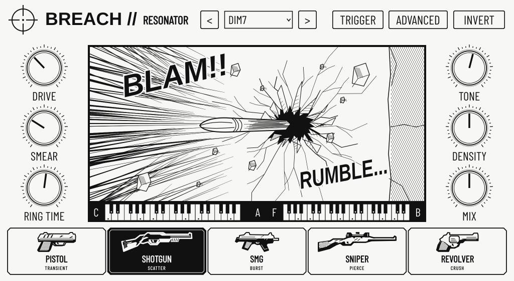

# BREACH // RESONATOR 2.0.1

**User manual** · [简体中文](User-Manual.zh-CN.md)

BREACH turns audio into pitched resonances. It accepts signals such as drums, vocals, guitar, or synths and tunes its resonator voices to a chord or to MIDI notes from the host.



## 1. Install and start

1. Download the platform package from [GitHub Releases](https://github.com/yunm4833-design/gun-vst/releases/tag/2.0.1) and extract it.
2. On macOS, copy the entire `.vst3` bundle to `~/Library/Audio/Plug-Ins/VST3/` or the entire `.component` to `~/Library/Audio/Plug-Ins/Components/`. Logic Pro loads the AU component. The Standalone `.app` can go in Applications. The Universal package supports Apple silicon and Intel.
3. On Windows x64, copy the entire `.vst3` bundle to `C:\Program Files\Common Files\VST3\`. To run the Standalone EXE, extract the package to a folder first.
4. Rescan plug-ins in your DAW and insert **BREACH Resonator** on an audio track or bus. In Standalone, select an audio input and output in the app's audio device settings.
5. Play input audio, choose a chord in the top bar, and start with moderate **MIX** and **DRIVE**. Switch modes while listening, then set **RING TIME** for the amount of sustain you want.

The macOS packages from CI are unsigned for distribution. macOS or the host may ask you to approve a downloaded plug-in before scanning it.

## 2. Signal flow and main panel

```text
Audio input -> OTT (optional) -> INPUT GAIN
            -> dry path + [excitation -> resonator -> SMEAR
                          -> frequency shift -> TONE -> WIDTH]
            -> MIX -> G // EQ -> F // REVERB -> OUTPUT GAIN -> SOFT LIMITER
```

| Control | What you hear or see |
| --- | --- |
| **DRIVE** | Excitation saturation. Higher settings add harmonics before the resonator. |
| **SMEAR** | Short diffusion of the wet signal. Increase it to spread the attack over a short time. |
| **RING TIME** | Nominal resonator decay for the selected model. Damping, note frequency, modulation, and per-voice trim affect the audible tail. |
| **TONE** | Wet-path tilt. Turn left for a darker balance and right for a brighter one. |
| **DENSITY** | How strongly additional resonator voices contribute. |
| **MIX** | Blend between the dry path and resonator output. EQ and reverb follow this blend. |

The manga panel responds to audio. Speed lines track excitation, sharp onsets trigger an impact, and cracks follow individual voices before reverb. The two halftone meters show final L/R output, so they can keep moving after the cracks fade. **TRIGGER** previews the picture. **ADVANCED** opens the tabs, and **INVERT** switches ink and paper colors.

| Mode | Starting point |
| --- | --- |
| **PISTOL / TRANSIENT** | Short, pitched hits for drums and percussion. |
| **SHOTGUN / SCATTER** | Dispersive string and waveguide textures for noisy or picked sources. |
| **SMG / BURST** | Formant colors for metallic or vowel-like motion. |
| **SNIPER / PIERCE** | Focused high-Q resonance for a narrow pitched accent. |
| **REVOLVER / CRUSH** | Dense modal resonance for longer harmonic textures. |

Click a piano key in the strip to toggle its pitch class. The top menu offers ten chord presets, with arrows to step through them. Right-click the piano strip to set root, octave spread (1-4), and voice cap (4/6/8/12), or to enable **MIDI**, **ARP**, or **MOTION**. MIDI provides pitches while the audio input supplies excitation. With no held MIDI notes, BREACH uses the panel's pitch classes. **PANIC** in this settings panel clears active audio tails.

## 3. Voices, resonator, and modulation

### A // VOICES

**TUNE SPREAD** adds relative tuning offsets across the chord. **PAN SPREAD** spreads voices across the stereo field. Open **VOICE EDIT** to select V1-V12 and set **LEVEL**, **PAN**, **TUNE**, and **RING TRIM** for one voice. **RING TRIM** multiplies the main ring time.

### B // RESONATOR

Use **AUTO (GUN MODE)** to let the selected mode choose its topology. The other options select a bandpass, comb string, or dual formant explicitly. Use **ATTACK** for the voice envelope, **FB DAMPING** for losses in the resonator, and **STIFFNESS** for dispersion. **EXC INPUT CUT** and **EXC DRIVE** shape what excites the resonator. To cut lows across the entire mix, use **G // EQ**.

### C // MODULATION

Two LFOs and an envelope follower are available as sources. Choose **SOURCE** and **DESTINATION**, then click **ADD**. Select an existing route to edit its signed **AMOUNT**, or click **CLEAR** to set it to zero. LFO sync uses host tempo where available. **SHIFT (HZ)** shifts spectrum components in hertz, and **UNISON** spreads the stereo tuning.

### D // GLOBAL

Set input/output levels, stereo width, the mix curve, and **1X**, **2X**, or **4X** oversampling. Higher oversampling can reduce aliasing from nonlinear processing at a higher CPU cost. **SOFT LIMITER** acts at the output. Compatibility switches select earlier DSP revisions for older projects or A/B comparisons.

## 4. Dynamics, reverb, and EQ

### E // DYNAMICS

Enable **OTT** to process the input before the resonator. **DEPTH** sets the overall dynamics strength. At 0%, the module bypasses. **TIME** scales release in the Faust model, with 100% as the reference. **UPWARD** raises quiet details, and **DOWNWARD** reduces peaks. The three meters show the signed gain change in dB for **LOW**, **MID**, and **HIGH**. Use **OUT GAIN** to match the level when comparing with bypass. **SETUP** exposes input gain, both crossover frequencies, and the **FAUST / CLASSIC** model selector.

### F // REVERB

Enable reverb after the main mix and EQ. Choose **HALL** for an open space, **PLATE** for a compact dense tail, **SPACE** for a larger sparse tail, or **SHIMMER** for an octave-up layer. Set its blend, decay, predelay, damping, and width. The **SHIMMER** amount is available in Shimmer mode. Reverb **DECAY** sets this late tail, and main **RING TIME** sets the resonator decay.

### G // EQ

Enable **EQ** and select a numbered band. Band 1 starts at 80 Hz with a 24 dB/oct low cut. Drag a node horizontally for frequency, vertically for gain on bells and shelves, and vertically for Q on cuts and notches. Alt-drag a bell to change Q. Double-click a node to toggle the band, or use the selected-band controls for precise edits. A low cut here affects the entire mixed signal and the feed into reverb. An existing reverb tail can remain audible briefly after an EQ change.

## 5. Session recall and troubleshooting

- **Reuse a project.** BREACH retains the existing host parameter IDs and plug-in identity. Earlier projects load their saved or compatible DSP revisions. An older OTT session without a model setting loads **CLASSIC**. A new instance defaults to **FAUST** when OTT is enabled.
- **No resonance.** Check that there is input audio, that **MIX** is above zero, and that the voice level, output level, and host routing are audible.
- **Too much bass or too long a tail.** Use the low cut in **G // EQ** for bass across the mix. Shorten **RING TIME** for the resonator or reduce **DECAY** in **F // REVERB** for the late tail.
- **Plug-in missing.** Confirm the platform and format, copy the complete bundle, and rescan using the host's plug-in manager.

Third-party model credits and licenses are in the [Licenses folder](https://github.com/yunm4833-design/gun-vst/tree/2.0.1/Licenses).
