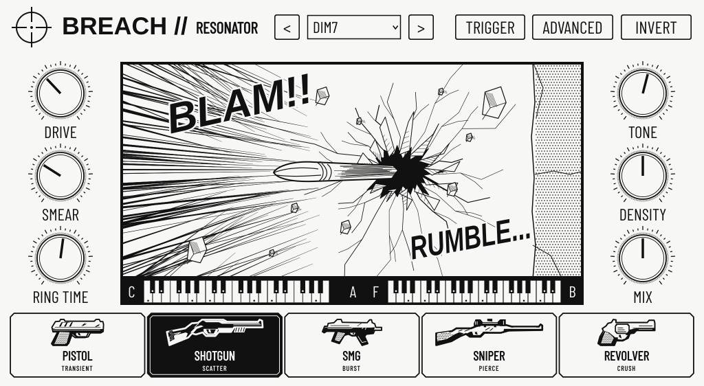

# BREACH // RESONATOR 2.0.1

**中文使用说明书** · [English](User-Manual.md)

BREACH 是一款立体声共鸣效果器。它接收鼓、吉他、人声、合成器等音频，再按面板和弦或宿主传入的 MIDI 音符调谐共鸣声部。



## 1. 安装与首次使用

1. 在 [GitHub Releases](https://github.com/yunm4833-design/gun-vst/releases/tag/2.0.1) 下载对应平台的 ZIP 并解压。
2. **macOS**：将完整的 `.vst3` 放入 `~/Library/Audio/Plug-Ins/VST3/`，或将完整的 `.component` 放入 `~/Library/Audio/Plug-Ins/Components/`。Logic Pro 使用 AU。独立版 `.app` 可放入“应用程序”。Universal 包支持 Apple 芯片和 Intel。
3. **Windows x64**：将完整的 `.vst3` 放入 `C:\Program Files\Common Files\VST3\`。独立版可解压到应用目录后运行 EXE。
4. 打开 DAW 的插件管理器重新扫描，并把 **BREACH Resonator** 插入音频轨或总线。独立版需要在音频设备设置中选择输入和输出。
5. 播放素材，在顶部选一个和弦，将 **MIX** 和 **DRIVE** 从适中的位置开始调。切换五种模式，最后用 **RING TIME** 调节共鸣留音。

macOS 云端包未进行发行签名。首次扫描时，macOS 或宿主可能会要求先批准下载的插件。

## 2. 信号链与主面板

```text
INPUT -> OTT -> INPUT GAIN
      -> DRY + [EXCITATION -> RESONATOR -> SMEAR -> SHIFT -> TONE -> WIDTH]
      -> MIX -> G // EQ -> F // REVERB -> OUTPUT GAIN -> SOFT LIMITER
```

| 旋钮 | 功能 |
| --- | --- |
| **DRIVE** | 共鸣前的激励饱和。增大后会增加谐波。 |
| **SMEAR** | 湿声的短扩散。增大后，起音会在较短时间内散开。 |
| **RING TIME** | 当前共鸣模式的标称衰减时间。阻尼、音高、调制和各声部微调都会影响实际尾音。 |
| **TONE** | 共鸣支路的倾斜均衡，向左更暗，向右更亮。 |
| **DENSITY** | 额外共鸣声部参与的程度。 |
| **MIX** | 干声与共鸣湿声的比例。混合信号随后进入 EQ 与混响。 |

中央分镜由真实音频驱动。速度线跟随激励，明显起音触发破口，裂纹跟随混响前的各个共鸣声部。右侧网点显示最终 L/R，因而裂纹消失后仍可看到混响尾音。顶部 **TRIGGER** 可预览动画，**ADVANCED** 打开高级面板，**INVERT** 切换黑白主题。

| 模式 | 使用起点 |
| --- | --- |
| **PISTOL / TRANSIENT** | 短促的有调性敲击，适合鼓点。 |
| **SHOTGUN / SCATTER** | 带色散的波导弦振，适合拨弦和噪声激励。 |
| **SMG / BURST** | 带共振峰的金属音色和元音变化。 |
| **SNIPER / PIERCE** | 集中的高 Q 共鸣，用于突出单一音高或谐波。 |
| **REVOLVER / CRUSH** | 厚重的多模态共鸣，适合延长和声质感。 |

点击键盘音符可切换该半音。顶部菜单有十种和弦预设，左右箭头可逐个切换。右键点击键盘条，可调根音、1–4 八度、4/6/8/12 声部上限，以及 **MIDI、ARP、MOTION**。MIDI 提供音高，输入音频负责激励。没有按住 MIDI 音符时，插件使用面板音级。此设置页里的 **PANIC** 可清除当前音频尾音。

## 3. 声部、共鸣与调制

### A // VOICES

**TUNE SPREAD** 为和弦中的多个声部增加相对音分偏移。**PAN SPREAD** 控制声像展开。打开 **VOICE EDIT**，选择 V1–V12，再编辑单声部的 **LEVEL、PAN、TUNE、RING TRIM**。**RING TRIM** 是主共鸣时间的倍率。

### B // RESONATOR

**AUTO (GUN MODE)** 由五种模式自动选择共鸣拓扑，也可以手选带通、梳状弦振或双共振峰。**ATTACK** 控制声部包络，**FB DAMPING** 控制反馈损耗，**STIFFNESS** 控制色散。**EXC INPUT CUT** 和 **EXC DRIVE** 作用于进入共鸣器的激励。要对整个混合信号切低频，请使用 **G // EQ**。

### C // MODULATION

可用两个 LFO 和一个包络跟随器作为源。选好 **SOURCE** 和 **DESTINATION** 后点击 **ADD**。选中已有路线可调带正负号的 **AMOUNT**，**CLEAR** 将它归零。LFO 同步会使用可用的宿主速度。**SHIFT (HZ)** 以 Hz 为单位移动频谱成分，**UNISON** 展开立体声调谐。

### D // GLOBAL

这里可调输入输出增益、立体声宽度、混合曲线和 **1X、2X、4X** 过采样。较高倍率能减少非线性处理的混叠，同时增加 CPU 开销。**SOFT LIMITER** 位于最终输出。兼容性开关可以选回早期 DSP 版本。

## 4. 压缩、混响与 EQ

### E // DYNAMICS

打开 **OTT** 后，三段压缩会先处理输入，再由信号激励共鸣器。**DEPTH** 调总体强度，0% 完全旁路。Faust 模型的 **TIME** 调释放时间，100% 对应基准速度。**UPWARD** 抬升弱细节，**DOWNWARD** 压低强峰。右侧三条表按 dB 显示各段抬升或压低多少。用 **OUT GAIN** 调平电平再比较。**SETUP** 中可调输入增益、两个分频点，并切换 **FAUST / CLASSIC**。

### F // REVERB

混响位于主混合和 EQ 之后。**HALL** 是开阔大厅，**PLATE** 是紧凑密集的板式尾音，**SPACE** 是较大而疏散的空间，**SHIMMER** 带高八度音层。可调混合比例、衰减、预延迟、阻尼和宽度。在 Shimmer 模式可单独调八度层。此处的 **DECAY** 控制混响尾音，主面板 **RING TIME** 控制共鸣衰减。

### G // EQ

启用 **EQ** 后选择编号频段。第一段预设为 80 Hz、24 dB/oct 低切。节点横拖改频率，钟形与搁架纵拖改增益，切频与陷波纵拖改 Q。按住 Alt 拖动钟形节点可调 Q。双击节点切换频段开关，也可在当前频段的控制区输入精确数值。这里的低切作用于整个混合信号，也会改变送入混响的频谱。已经产生的混响尾音可能仍持续一小段时间。

## 5. 旧工程和常见问题

- **打开旧工程。** BREACH 保留宿主参数 ID 和插件标识，按工程保存值恢复或使用相应的兼容 DSP 模式。未记录 OTT 模型的旧工程读取 **CLASSIC**。新实例启用 OTT 时使用 **FAUST**。
- **听不到共鸣。** 确认输入有音频、**MIX** 大于零，并检查声部电平、输出和宿主路由。
- **低频过多或尾音过长。** 在 **G // EQ** 启用低切。要缩短共鸣，减小 **RING TIME**。要缩短后级混响，减小 **F // REVERB** 的 **DECAY**。
- **宿主找不到插件。** 检查系统与格式，完整复制插件包，再从宿主插件管理器重新扫描。

第三方模型来源和许可见 [Licenses 目录](https://github.com/yunm4833-design/gun-vst/tree/2.0.1/Licenses)。
