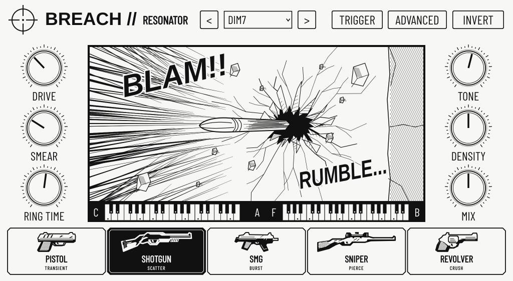

# BREACH // RESONATOR 2.0.1

**English** | [简体中文](README_CN.md)

BREACH is a stereo audio effect that turns incoming drums, guitars, synths, and other sounds into tuned resonance. Choose a chord or route MIDI notes from your host, then shape the result with five resonator models and up to 12 voices.



[Download 2.0.1](https://github.com/yunm4833-design/gun-vst/releases/tag/2.0.1) · [User manual](Docs/User-Manual.md) · [中文说明书](Docs/User-Manual.zh-CN.md) · [Build guide](BUILD_GUIDE.md)

## What's in 2.0.1

- Five resonator modes with updated string, formant, modal, and high-Q processing. **RING TIME** sets the nominal resonator decay, with individual voice trim under **A // VOICES**.
- An audio-driven manga panel. Speed lines follow the excitation, impacts follow onsets, cracks follow the individual resonances, and the halftone meters show final left/right output.
- Three-band **OTT** input dynamics based on the MIT-licensed Faust model. **DEPTH**, **TIME**, **UPWARD**, and **DOWNWARD** sit alongside three gain-change meters. Input gain and crossovers are under **SETUP**.
- Eight-band output EQ with draggable nodes, four post-mix reverb models, and **SMEAR** for short diffusion.
- Existing host parameter IDs and plug-in identity are retained. Older saved states use their stored or legacy DSP revisions. New instances use the current models.

## Platforms and installation

| Platform | Formats | Install location |
| --- | --- | --- |
| macOS Universal (Apple silicon and Intel) | VST3, AU, Standalone | `~/Library/Audio/Plug-Ins/VST3/`, `~/Library/Audio/Plug-Ins/Components/`, or Applications for Standalone |
| Windows x64 | VST3, Standalone | `C:\Program Files\Common Files\VST3\`, or an application folder for Standalone |

Extract the platform ZIP and copy the entire plug-in bundle to the relevant folder. Rescan plug-ins in your DAW and insert **BREACH Resonator** on an audio track. Keep the input playing while you choose a chord and adjust **MIX**.

## Build from source

The project uses JUCE 8.0.4, C++17, and CMake 3.22 or newer. CMake fetches JUCE automatically.

```sh
cmake -S . -B build -DCMAKE_BUILD_TYPE=Release
cmake --build build --config Release --parallel
```

Third-party notices and model attributions are in [Licenses](Licenses/).
