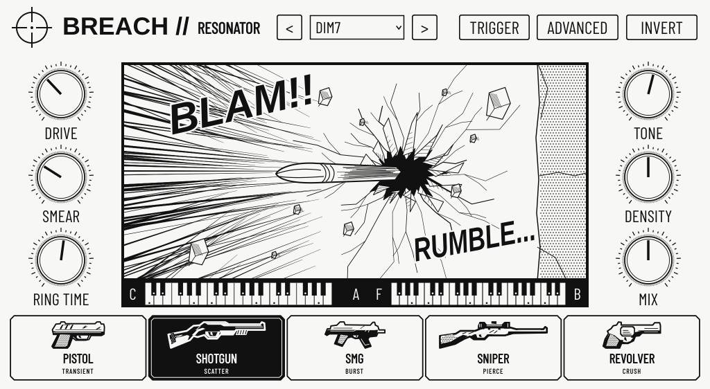

# BREACH // RESONATOR 2.0.1

[English](README.md) | **简体中文**

BREACH 是一款立体声共鸣音频效果器。它将输入的鼓、吉他、合成器和其他音频变成有音高的共鸣。可在面板上选和弦，也可由宿主发送 MIDI 音符，再用五种共鸣模式和最多 12 个声部塑造音色。



[下载 2.0.1](https://github.com/yunm4833-design/gun-vst/releases/tag/2.0.1) · [中文使用说明书](Docs/User-Manual.zh-CN.md) · [English Manual](Docs/User-Manual.md) · [构建指南](BUILD_GUIDE.md)

## 2.0.1 功能

- **五种共鸣模式**升级了弦振、共振峰、多模态和高 Q 处理。主面板 **RING TIME** 控制共鸣的标称衰减时间，**A // VOICES** 负责单独微调各个声部。
- **实时音频分镜**用速度线显示激励、用破口显示瞬态、用裂纹显示各声部的共鸣衰减，右侧网点显示最终左右声道电平。
- **三段 OTT** 使用基于 Xfer OTT 实测的 Faust MIT 开源模型。主面板显示各段压低或抬升的 dB 值，输入增益和分频点放在 **SETUP**。
- **八段输出 EQ** 支持拖动节点。独立混响有 **HALL、PLATE、SPACE、SHIMMER** 四种模式，主面板 **SMEAR** 控制短扩散。
- 保留原有宿主参数 ID 和插件标识。旧工程读取已保存或兼容的 DSP 模式，新实例使用当前模型。

## 下载与安装

| 平台 | 格式 | 安装位置 |
| --- | --- | --- |
| macOS Universal（Apple 芯片与 Intel） | VST3、AU、独立版 | VST3 放入 `~/Library/Audio/Plug-Ins/VST3/`，AU 放入 `~/Library/Audio/Plug-Ins/Components/`，独立版可放入“应用程序” |
| Windows x64 | VST3、独立版 | VST3 放入 `C:\Program Files\Common Files\VST3\`，独立版可解压到应用目录后运行 |

解压对应平台的 ZIP，完整复制插件包，在 DAW 重新扫描。将 **BREACH Resonator** 插入有输入的音频轨，播放素材，选择一个和弦后调整 **MIX**。

## 从源码构建

工程使用 JUCE 8.0.4、C++17 和 CMake 3.22 或以上版本。CMake 会自动下载 JUCE。

```sh
cmake -S . -B build -DCMAKE_BUILD_TYPE=Release
cmake --build build --config Release --parallel
```

开源模型的来源和第三方许可见 [Licenses](Licenses/)。
